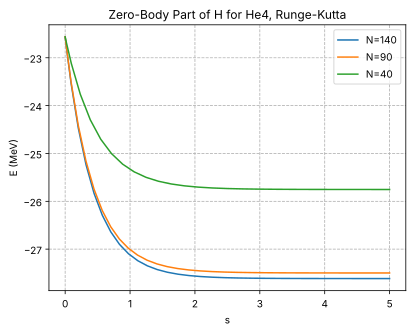

# In-Medium Similarity Renormalization Group in C++

A C++ implementation of the single-reference **IM-SRG(2)** for the ground state of $^4$He.

The Hamiltonian is normal-ordered with respect to a reference state and split into a zero-body part $E$, a one-body part $f$ and a two-body part $\Gamma$. It is then evolved with the flow equation

$$\frac{dH(s)}{ds} = [\eta(s), H(s)]$$

until the particle–hole couplings are suppressed and $E(s)$ approaches the ground-state energy.

## Features

- Reads two-body matrix elements of a chiral NN interaction from `matrix_elements/`
- White-type generator $\eta$ built from the particle–hole parts of $f$ and $\Gamma$
- Flow equations for $dE/ds$, $df/ds$ and $d\Gamma/ds$, parallelised with **OpenMP**
- Integration with an explicit **Euler** scheme or an adaptive **Runge–Kutta** solver from the GSL
- Export of $E$, $f$, $\Gamma$ and $\eta$ during the flow, with Python scripts in `src/visualize/` that plot them as functions of $s$

## Build & run

Requires `g++` with OpenMP and the GNU Scientific Library.

```bash
make
./build/bin/IM-SRG -i rk -N 140 -s 5 -d 1e-6
```

Run it from the repository root.

| Flag | Meaning | Default |
|---|---|---|
| `-i` | integrator: `rk` (Runge–Kutta) or `e` (Euler) | `rk` |
| `-N` | number of single-particle states (0–140) | 140 |
| `-s` | integrate the flow from 0 up to this value of $s$ | 1 |
| `-d` | step size (initial step size for Runge–Kutta) | 0.1 |

Output files and plots go to [`output/`](output), for example the energy flow in [`output/plots/E_rk_N.pdf`](output/plots/E_rk_N.pdf).



